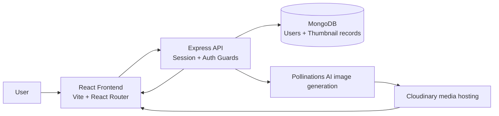
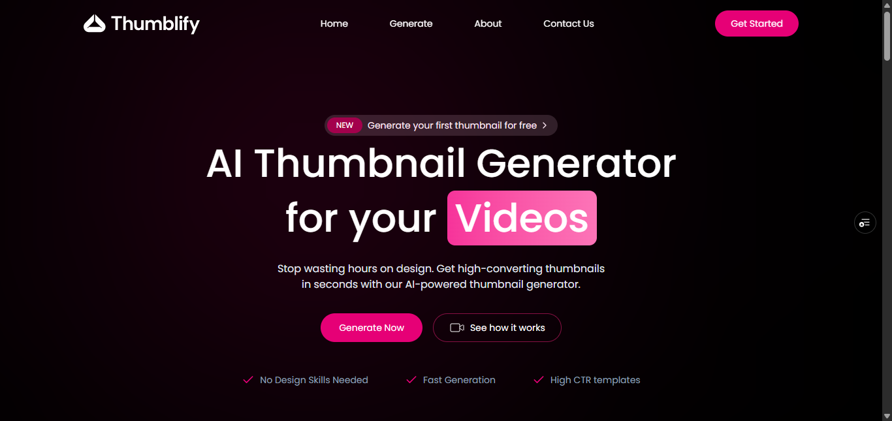
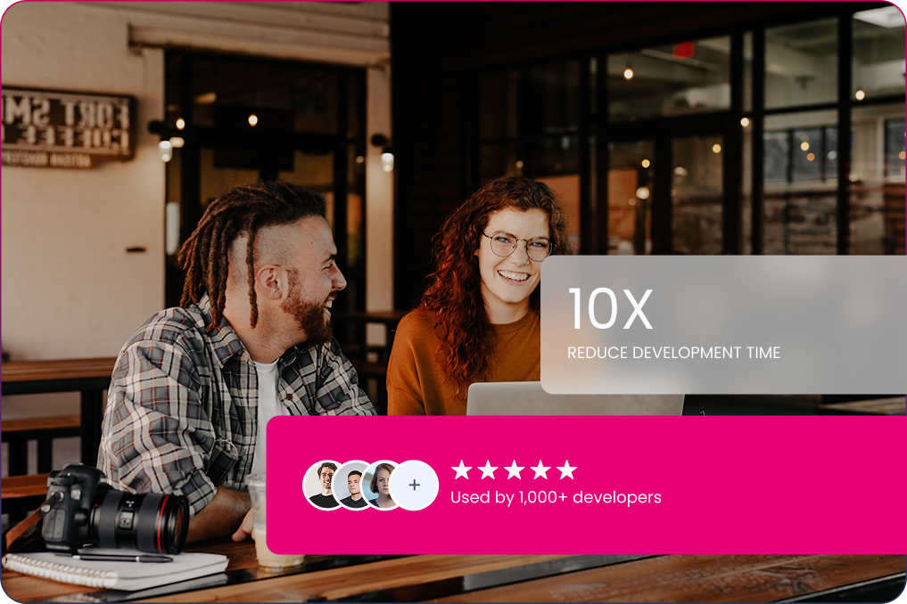
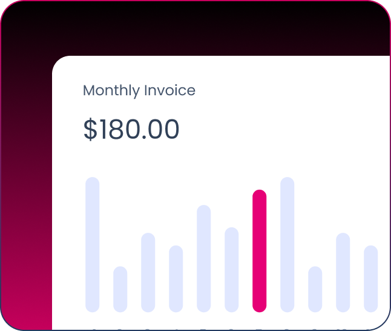

# Thumblify

<p align="center">
  
</p>

<p align="center">
  <a href="https://github.com/hilla10/thumblify">GitHub</a> ·
  <a href="https://thumblify-mpq1.vercel.app/">Live Demo</a>
</p>

<p align="center">
  
  
  
  
  
  
</p>

Thumblify is an AI-powered thumbnail generator for creators, educators, and brands who want high-converting YouTube and social thumbnails without hiring a designer. The app combines a sleek React frontend with a Node.js/Express backend and an AI image generation pipeline to create custom thumbnails from a title, visual style, aspect ratio, and optional prompt details.

## Why this project exists

Creating eye-catching thumbnails usually takes design skills, time, and iteration. Thumblify solves that by letting users:

- describe a video topic in plain language
- choose a design style and color mood
- generate a thumbnail in seconds
- save and review previous generations
- download or preview created designs

## Key features

### Core functionality

- AI-generated YouTube thumbnail creation from a title and prompt
- Multiple visual styles: Bold & Graphic, Minimalist, Photorealistic, Illustrated, and Tech/Futuristic
- Aspect ratio selection for 16:9, 1:1, and 9:16
- Color palette customization
- Prompt-driven refinements for more specific visual direction
- Session-based user authentication
- Saved generation history per authenticated user
- Thumbnail preview and deletion from the dashboard
- Downloadable output image files

### User experience

- Responsive landing page and dashboard UI
- Modern glassmorphism-inspired design system
- React Router navigation for Home, Generate, Preview, Login, and My Generations pages
- Toast notifications for auth and generation events

## Tech stack

| Category          | Technologies                                                                        |
| ----------------- | ----------------------------------------------------------------------------------- |
| Frontend          | React 19, Vite, TypeScript, Tailwind CSS, React Router, Axios, Motion, Lucide React |
| Backend           | Node.js, Express 5, TypeScript                                                      |
| Database          | MongoDB, Mongoose                                                                   |
| Session/auth      | Express Session, connect-mongo                                                      |
| AI generation     | Pollinations image API                                                              |
| Media hosting     | Cloudinary                                                                          |
| API communication | REST API via Axios                                                                  |
| Deployment        | Vercel-compatible frontend and Node server deployment                               |
| Dev tooling       | ESLint, TypeScript compiler, Nodemon, tsx                                           |

## Architecture overview



The frontend handles user interaction, form input, and thumbnail previews. The backend secures requests with session cookies and validates the logged-in user before generation or fetch operations. Generated thumbnails are stored in MongoDB along with metadata such as style, aspect ratio, prompt text, and image URL.

## Screenshots

> The project includes actual image assets in the frontend public folder. These are used here as repository screenshots.

<div align="center">
  
</div>

<div align="center">
  
  
</div>

## Project structure

```text
thumblify/
├── client/
│   ├── public/
│   │   ├── assets/
│   │   ├── favicon.svg
│   │   ├── hero_img.png
│   │   ├── logo.svg
│   │   └── ...
│   ├── src/
│   │   ├── assets/
│   │   ├── components/
│   │   ├── configs/
│   │   ├── context/
│   │   ├── data/
│   │   ├── pages/
│   │   ├── sections/
│   │   ├── App.tsx
│   │   ├── globals.css
│   │   └── main.tsx
│   ├── .eslintrc* files and Vite configs
│   ├── index.html
│   ├── package.json
│   └── vite.config.ts
├── server/
│   ├── configs/
│   ├── controllers/
│   ├── middlewares/
│   ├── models/
│   ├── routes/
│   ├── .env.example
│   ├── package.json
│   ├── server.ts
│   └── tsconfig.json
├── .gitignore
├── README.md
└── .git
```

### Important folders

- `client/src/pages` — landing page, generation workflow, preview page, and user history
- `client/src/components` — reusable UI pieces like login, selectors, preview, and navbar
- `client/src/context` — auth state and session management
- `server/controllers` — registration, login, logout, thumbnail generation, and thumbnail lookup
- `server/models` — MongoDB schemas for users and generated thumbnails
- `server/routes` — REST endpoints for auth and thumbnail actions

## Prerequisites

Before running the app locally, install:

- Node.js 18+ recommended
- npm
- MongoDB Atlas or a local MongoDB instance
- A Pollinations API key
- A Cloudinary account and Cloudinary URL
- Git

## Installation and setup

### 1) Clone the repository

```bash
git clone https://github.com/hilla10/thumblify.git
cd thumblify
```

### 2) Install frontend dependencies

```bash
cd client
npm install
```

### 3) Install backend dependencies

```bash
cd ../server
npm install
```

### 4) Configure environment variables

Create a `.env` file inside `server/` based on the example:

```bash
cp .env.example .env
```

Example values:

```env
PORT=3000
NODE_ENV=development
SESSION_SECRET=your_secure_session_secret
MONGODB_URI=mongodb+srv://<user>:<password>@<cluster>.mongodb.net/thumblify
POLLINATIONS_API_KEY=your_pollinations_api_key
CLOUDINARY_URL=cloudinary://<api_key>:<api_secret>@<cloud_name>
```

For the frontend, create a `.env` in `client/` if you need a custom backend base URL:

```env
VITE_BASE_URL=http://localhost:3000
```

## Running the app

### Start the backend

```bash
cd server
npm run server
```

or for a one-off start:

```bash
cd server
npm start
```

### Start the frontend

```bash
cd client
npm run dev
```

The app typically runs at:

- Frontend: `http://localhost:5173`
- Backend: `http://localhost:3000`

## Environment variables

### Backend variables

| Name                   | Required | Purpose                                            |
| ---------------------- | -------- | -------------------------------------------------- |
| `PORT`                 | No       | Express server port                                |
| `NODE_ENV`             | No       | Runtime environment flag                           |
| `SESSION_SECRET`       | Yes      | Used for cookie/session encryption                 |
| `MONGODB_URI`          | Yes      | MongoDB connection string                          |
| `POLLINATIONS_API_KEY` | Yes      | Auth for AI image generation                       |
| `CLOUDINARY_URL`       | Yes      | Cloudinary connection string used for image upload |

### Frontend variables

| Name            | Required | Purpose                       |
| --------------- | -------- | ----------------------------- |
| `VITE_BASE_URL` | No       | API base URL for the frontend |

## API endpoints

All protected routes use Express session authentication.

| Method   | Endpoint                    | Description                                   | Auth |
| -------- | --------------------------- | --------------------------------------------- | ---- |
| `POST`   | `/api/auth/register`        | Create a new account                          | No   |
| `POST`   | `/api/auth/login`           | Sign in to an existing account                | No   |
| `POST`   | `/api/auth/logout`          | End the current session                       | Yes  |
| `GET`    | `/api/auth/verify`          | Get current user data                         | Yes  |
| `POST`   | `/api/thumbnail/generate`   | Generate a thumbnail from a prompt + settings | Yes  |
| `DELETE` | `/api/thumbnail/delete/:id` | Delete a thumbnail record                     | Yes  |
| `GET`    | `/api/user/thumbnails`      | List all thumbnails for the logged-in user    | Yes  |
| `GET`    | `/api/user/thumbnail/:id`   | Fetch a specific thumbnail                    | Yes  |

## Database and data models

The application uses MongoDB with Mongoose.

### `User`

Fields include:

- `name`
- `email`
- `password`
- timestamps (`createdAt`, `updatedAt`)

### `Thumbnail`

Fields include:

- `userId`
- `title`
- `description`
- `style`
- `aspect_ratio`
- `color_scheme`
- `text_overlay`
- `image_url`
- `prompt_used`
- `user_prompt`
- `isGenerating`
- timestamps

Generated records are linked by `userId` and sorted by newest-first for the user gallery.

## Usage guide

1. Open the app in the browser.
2. Create an account or log in.
3. Navigate to the Generate screen.
4. Enter a title and optional extra prompt details.
5. Pick a visual style, aspect ratio, and color scheme.
6. Click `Generate Thumbnail`.
7. Wait for the AI to generate the image.
8. Preview, download, or delete the output from the gallery.

## Deployment

The project is structured for a frontend + backend split and can be deployed to services such as Vercel, Render, Railway, or a custom Node host.

### Frontend deployment

- Deploy the `client/` app as a Vite app on Vercel or similar.
- Set `VITE_BASE_URL` to the deployed API origin.

### Backend deployment

- Deploy the `server/` app as a Node.js service.
- Configure the environment variables above in the deployment platform.
- Ensure CORS allows the deployed frontend origin.

### Production note

The server currently allows a Vercel origin in `server/server.ts`:

```ts
'https://thumblify-mpq1.vercel.app';
```

This indicates the project has already been prepared for a Vercel-hosted frontend deployment.

## Security considerations

The codebase includes several relevant safeguards:

- password hashing with `bcrypt`
- session-based authentication using Express Session
- protected backend routes behind an auth middleware
- input validation for email and password during registration
- CORS restrictions to known frontend origins

Recommended follow-ups:

- add rate limiting to public auth endpoints
- add request validation middleware for thumbnail generation
- rotate and store sensitive credentials in platform secret managers
- avoid committing `.env` files to source control

## Troubleshooting

### MongoDB connection errors

- Confirm `MONGODB_URI` is correct.
- Ensure your database user has the required permissions.

### Session/auth issues

- Check that `SESSION_SECRET` is set and non-empty.
- Make sure cookies are enabled in the browser.
- Confirm the frontend is sending `withCredentials: true`.

### Image generation fails

- Check that `POLLINATIONS_API_KEY` is valid.
- Verify the API requests are not blocked by outbound restrictions.
- Confirm `Cloudinary` is configured for the upload step.

### Frontend cannot reach backend

- Verify `VITE_BASE_URL` points to the correct API origin.
- Check if backend CORS includes your localhost or deployed frontend URL.

## Roadmap

Potential improvements for future iterations:

- add user profile management
- support social platform presets beyond YouTube thumbnails
- add multi-image generation or batch outputs
- add drag-and-drop image editing
- integrate premium subscription or usage limits
- add comments/reviews for saved generations
- add a proper admin dashboard and analytics

## Contributing

Contributions are welcome.

```bash
git checkout -b feature/your-feature-name
git add .
git commit -m "feat: add your feature"
git push origin feature/your-feature-name
```

Then open a pull request on GitHub.

## License

This project is licensed under the [MIT License](./LICENSE).

## Author

The project footer identifies the maintainer as "Haila" and the repository is owned by `hilla10`.

- Repository: https://github.com/hilla10/thumblify
- Live demo: https://thumblify-mpq1.vercel.app
- LinkedIn: https://www.linkedin.com/in/hailemichaelnegusse

## Acknowledgements

This project uses or integrates:

- React
- Vite
- Express
- MongoDB + Mongoose
- Pollinations AI
- Cloudinary
- Tailwind CSS
- Lucide icons
- Motion / Framer Motion-inspired animation package

## Final note

Thumblify is a practical AI thumbnail generator built for fast content creation and visual experimentation. It is ready to be extended with more templates, better image-generation controls, analytics, and monetization features.
